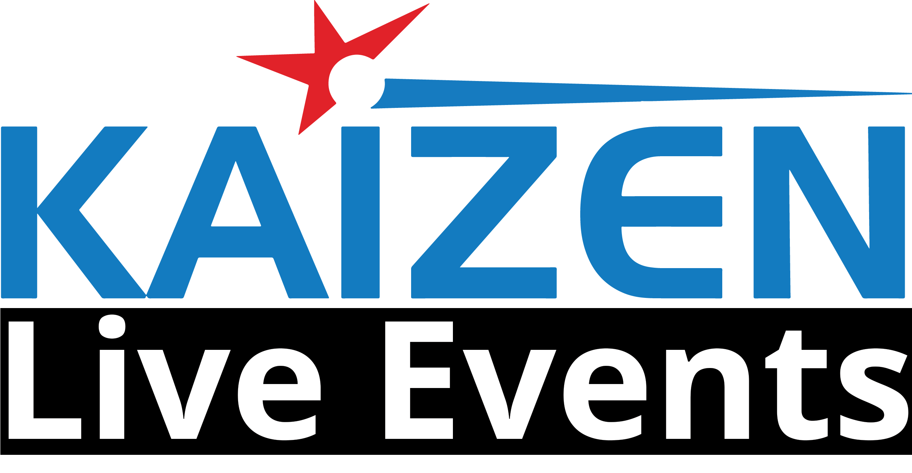

# Kaizen Events - Event Registration Platform

<p align="center">
  
</p>

<p align="center">
  <strong>A comprehensive event registration and management platform</strong><br>
  Built for Kaizen Events to manage event campaigns, registrations, payments, and communications.
</p>

---

## 📋 Table of Contents

- [Overview](#overview)
- [Features](#features)
- [Quick Start](#quick-start)
- [User Guide](#user-guide)
- [Documentation](#documentation)
- [Tech Stack](#tech-stack)

---

## Overview

Kaizen Events is an internal backend admin panel for managing event registration campaigns. Think of it as a self-hosted alternative to Zoho Forms with integrated payment processing and automation capabilities.

### What Can You Do?

| For Event Organizers | For Attendees |
|---------------------|---------------|
| Create event campaigns | Browse live events |
| Build custom registration forms | Register for events |
| Design landing pages | Make secure payments |
| Track registrations & revenue | Receive confirmation emails |
| Export data to Google Sheets | View registration status |
| Manage team access | |

---

## Features

### 🎯 Campaign Management
- **Create Campaigns**: Set up events with name, description, dates, and registration limits
- **Campaign Status**: Draft → Active → Archived workflow
- **Registration Window**: Set open/close dates for registrations
- **Manual Control**: Toggle registrations on/off instantly

### 📝 Form Builder
- **Drag-and-Drop**: Build custom registration forms
- **Field Types**: Text, email, phone, dropdown, checkbox, file upload, and more
- **Validation**: Required fields, email format, phone format
- **External Forms**: Option to use Google Forms, Typeform, etc.

### 🎨 Landing Page Builder
- **8 Pre-built Templates**: Tech Conference, Corporate Gala, Workshop, Product Launch, Charity, Sports, Wedding, Music Concert
- **Section Types**: Hero, About, Speakers, Schedule, Pricing, FAQ, Contact
- **Theme Customization**: Colors, fonts, backgrounds
- **Optional**: Can be disabled to send visitors directly to the form

### 💳 Payment Integration
- **Razorpay**: For card payments, UPI, wallets
- **Instamojo**: For payment links and bank transfers
- **External Webhooks**: Capture payments from external forms
- **Payment Tracking**: Real-time status updates

### 📊 Analytics & Reporting
- **Dashboard**: Registration trends, revenue charts
- **Export**: Download registrations as Excel
- **Google Sheets Sync**: Real-time data sync

### 👥 Team Management
- **Super Admin**: Full access to all features
- **Organisation Admin**: Access to assigned campaigns only
- **Team Members**: Granular permissions per campaign

### 📧 Communications
- **Email Notifications**: Registration confirmations via Resend
- **DKIM Setup**: Custom domain email authentication

---

## Quick Start

### For Administrators

1. **Login** at `/login` with your credentials
2. **Create a Campaign**: Dashboard → Campaigns → Create Campaign
3. **Build Your Form**: Campaign Detail → Manage Registration Form
4. **Set Up Payments**: Payment Accounts → Add your Razorpay/Instamojo credentials
5. **Go Live**: Activate the campaign and share the public URL

### For Public Users

1. **Browse Events**: Visit the homepage to see all live events
2. **Register**: Click on an event → Fill the form → Make payment
3. **Confirmation**: Receive email confirmation with registration details

---

## User Guide

### Creating Your First Campaign

```
1. Login as Super Admin
2. Go to Campaigns → Create Campaign
3. Fill in:
   - Campaign Name (e.g., "Annual Tech Conference 2026")
   - Slug (auto-generated, used in URLs)
   - Description
   - Registration Limit (optional)
4. Click Create
```

### Setting Up Registration Form

```
1. Open your campaign
2. Click "Manage Registration Form"
3. Drag fields from left panel to form
4. Configure each field (label, required, validation)
5. Save the form
```

### Configuring Payments

```
1. Go to Payment Accounts
2. Add New Account:
   - Choose Gateway (Razorpay or Instamojo)
   - Enter API credentials
   - Set as Active
3. In Campaign Settings:
   - Link the payment account
   - Enable payment collection
```

### Using External Forms with Instamojo

If you prefer using Google Forms or other external forms:

1. In Campaign → Registration Form Type → Select "External Form Link"
2. Copy the **Payment Webhook URL** shown
3. Create a payment link in Instamojo
4. Add the webhook URL to your Instamojo payment link settings
5. Payments will auto-sync to Kaizen Events

👉 See [Instamojo Webhook Setup Guide](docs/INSTAMOJO_WEBHOOK.md) for detailed instructions.

---

## Documentation

| Document | Description |
|----------|-------------|
| [Technical Documentation](docs/TECHNICAL.md) | Architecture, APIs, database schema |
| [Instamojo Webhook Guide](docs/INSTAMOJO_WEBHOOK.md) | External payment integration setup |
| [API Reference](docs/API_REFERENCE.md) | Complete API documentation |
| [Architecture Overview](docs/ARCHITECTURE.md) | System design and data flow |

---

## Tech Stack

| Layer | Technology |
|-------|------------|
| Frontend | React 18, Tailwind CSS, Shadcn UI |
| Backend | FastAPI (Python 3.11) |
| Database | MongoDB |
| Authentication | JWT Tokens |
| Payments | Razorpay, Instamojo |
| Email | Resend |
| Charts | Recharts |
| Export | SheetJS (xlsx) |

---

## Default Credentials

| Role | Email | Password |
|------|-------|----------|
| Super Admin | pranav@kaizeninfotech.com | Kaizentest1234 |
| Org Admin | withcamp@test.com | Test1234 |

⚠️ **Change these credentials before going to production!**

---

## Support

For issues or questions, contact the development team or raise an issue in this repository.

---

<p align="center">
  Made with ❤️ for Kaizen Events
</p>
